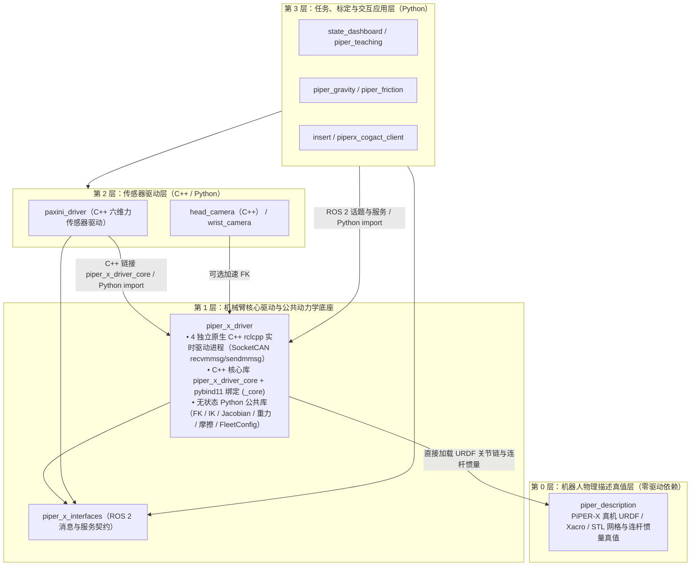

# PiPER-X workspace

硬件控制栈基于 **原生 C++17 (`rclcpp` + Linux SocketCAN) / PiPER-X V189 协议（固件 `S-V1.9-0` / `S-V1.9-1`）**，上层算法与交互应用运行于 ROS 2 Humble + Python 3.10。

## 文档索引

1. [四臂 C++ 驱动、共享动力学库与 ROS 2 接口文档](src/piper_x_driver/README.md)——C++ 实时架构、外部包 C++/Python `import` 指南、200 Hz 分层频率、重力/摩擦补偿、末端六维力估计及全部 ROS 话题/服务契约。
2. [CAN 层能力与逐条报文参考](src/piper_x_driver/CAN_PROTOCOL.md)——各报文方向、ID、字节、单位与 ROS 开放边界。

## 分层架构与单向依赖关系

全工作空间严格遵循**自上而下的单向依赖**，`piper_x_driver` 不反向依赖任何上层业务、传感器或视觉包：



- `piper_x_driver`：**全工作空间唯一机械臂 CAN 硬件入口与运动学/动力学真值底座**。在线运行由 4 个独立的原生 C++ `rclcpp` 驱动进程直接通过 Linux SocketCAN 控制 `/arm_1`～`/arm_4`（无 `pyAgxArm` / `python-can` 运行时依赖）；同时导出 C++ 头文件/库与 `pybind11` 加速的 Python 无状态数学配置接口供上层单向调用，详见 [驱动 README](src/piper_x_driver/README.md)。
- `piper_x_interfaces`：六关节目标必须完整；单位以 m、rad、rad/s、Nm 为主。
- `paxini_driver`：原生 C++ 六维力传感器驱动（直接链接 `piper_x_driver_core` 计算法兰重力方向完成实时负载重力扣除）及多姿态标定工具。
- `head_camera` / `wrist_camera`：头部双 RGB 相机 C++ HTTP 流服务与腕部 RTSP 相机/手眼外参工具包。
- `state_dashboard`：纯 ROS Web 客户端（默认 `127.0.0.1:8089`），提供四臂只读遥测总览与单臂全屏操控工作台（3D STL 姿态与实时力矢量、MIT 阻抗零重力/锁定跟踪、J/P/L 控制、力矩拆解与标零诊断），详见 [Dashboard README](src/state_dashboard/README.md)。
- `piper_teaching`：四臂主从（`master_slave`）与双向耦合（`bilateral`）示教客户端；重力补偿统一由驱动执行，详见 [示教 README](src/piper_teaching/README.md)。
- `piper_gravity`：关节重力补偿与静摩擦（双向准静态逼近 + 半和/半差解耦）标定客户端与模型库，详见 [重力标定 README](src/piper_gravity/README.md)。
- `piper_friction`：关节摩擦力与周期性齿槽/啮合脉动（Stribeck + 空间谐波）标定客户端与模型库，详见 [摩擦标定 README](src/piper_friction/README.md)。
- `insert` / `piperx_cogact_client`：基于力控与视觉的插孔策略、双臂观测采集与推理执行客户端。
- `piper_description`：**全工作空间最底层的 PiPER-X 物理几何与惯量真值包**（URDF/Xacro 与本体 STL 网格对齐 [`agilexrobotics/agx_arm_urdf`](https://github.com/agilexrobotics/agx_arm_urdf) `piper_x` 模型，零驱动依赖）；`piper_x_driver` 直接从其中的 URDF 加载 6 轴关节变换、连杆质量、质心与 3×3 惯性张量，RViz / Dashboard 3D 视图与底层动力学严格同源。
- `src/vendor/agx_arm_ros`：固定版本官方参考（`COLCON_IGNORE` 忽略编译）。

## 在其他包中复用正/逆运动学（FK / IK）、动力学与配置

凡是需要正/逆运动学、雅可比、重力/摩擦模型或读取 `arms.yaml` 的外部包，**直接本地 `import`（Python）或 `#include`（C++）`piper_x_driver` 提供的无状态纯函数库**（导入不会打开任何 CAN 端口或创建 ROS 节点，底层自动走同一份 C++ 实现）：

```python
from piper_x_driver import (
    FleetConfig,
    IkResult,
    default_config_path,
    forward_kinematics,       # 6 轴关节角 -> 4x4 T_base_tool 齐次变换矩阵
    inverse_kinematics,       # 4x4 矩阵或 [x,y,z,r,p,y] -> 6 轴关节角 (带 URDF 限位约束)
    link6_rotation_in_base,   # 6 轴关节角 -> 3x3 R_base_link6 旋转矩阵
    geometric_jacobian,       # 6x6 几何雅可比矩阵（frame="gripper" 或 "base_link"）
    gravity_torques,          # 6 轴 CAD 静态重力支撑力矩 (Nm)
    end_effector_wrench,      # 关节外力矩 -> 6 维末端力螺旋 (fx, fy, fz, tx, ty, tz)
    max_critical_kd,          # 由 kp 推导全姿态最大临界阻尼 kd
)

q = (0.0, 0.8, -1.2, 0.0, 0.4, 0.0)

# 1. 正/逆运动学：默认针对 link6，可传 link6 系下工具偏移 (x, y, z) m；IK 支持 4x4 矩阵或 6D [x,y,z,roll,pitch,yaw]
T_base_link6 = forward_kinematics(q)
T_base_tip = forward_kinematics(q, tool_offset_m=(0.0, 0.0, 0.16))
q_sol = inverse_kinematics(T_base_tip, q_seed=q, tool_offset_m=(0.0, 0.0, 0.16))

# 2. 读取四臂配置及带标定零偏/负载的正/逆运动学与重力矩
fleet = FleetConfig(default_config_path())
arm3_cfg = fleet.arm("arm_3")
g_model = fleet.gravity_model(arm3_cfg)
T_cal = g_model.forward_kinematics(q, tool_offset_m=(0.0, 0.0, 0.16))
q_cal = g_model.inverse_kinematics(T_cal, q_seed=q, tool_offset_m=(0.0, 0.0, 0.16))
tau_g = g_model.torques(q)
```

更多 C++ 头文件链接方式与完整 API 列表见 [`piper_x_driver` README](src/piper_x_driver/README.md#0-架构设计与外部包复用指南)。

## 环境与构建

工作空间通过 `direnv` 自动执行 [setup_env.bash](setup_env.bash)，加载 ROS 2、`.venv` 和已构建包。首次创建环境并构建：

```bash
cd /home/a/piper_x_ws
sudo apt install ros-humble-rmw-cyclonedds-cpp
sudo apt install direnv
direnv allow
uv venv --python 3.10 --system-site-packages
uv pip install --python .venv/bin/python -r requirements-dev.txt
CMAKE_BUILD_PARALLEL_LEVEL=2 .venv/bin/python /usr/bin/colcon build --symlink-install
ROS_DOMAIN_ID=213 python -m pytest -q
```

必须使用 `.venv/bin/python /usr/bin/colcon` 构建，确保生成的 ROS 入口脚本指向 `.venv` 解释器。

Python 测试覆盖公共数学库与上层客户端；依赖旧 Python 驱动的集成测试已移除。原生 C++ 驱动测试使用模拟机械臂，不连接真实硬件：

```bash
colcon test --packages-select piper_x_driver
colcon test-result --verbose
```

## 启动驱动、Dashboard 与示教

共享配置位于 [arms.yaml](src/piper_x_driver/config/arms.yaml)：

| CAN | 机械臂 / 命名空间 | 默认末端 |
|---|---|---|---|
| can0 | arm_1 / /arm_1 | 示教手柄 |
| can1 | arm_2 / /arm_2 | 示教手柄 |
| can2 | arm_3 / /arm_3 | 标准夹爪 |
| can3 | arm_4 / /arm_4 | 标准夹爪 |

先在系统中激活 `can0`～`can3`（波特率 `1000000`），各终端保持同一 `ROS_DOMAIN_ID`：

```bash
# 激活四路 SocketCAN 接口（设备断电重连或 USB 重枚举后需重新执行）
for iface in can0 can1 can2 can3; do sudo ip link set "$iface" type can bitrate 1000000 && sudo ip link set "$iface" up || break; done

# 终端 1：启动四臂驱动（启动后自动使能六关节并进入 MIT 重力补偿模式；Ctrl+C 退出时切入固件原生零力拖动）
ros2 launch piper_x_driver four_arms.launch.py

# 终端 2：启动 Web Dashboard（浏览器打开 http://127.0.0.1:8089/）
ros2 run state_dashboard state_dashboard --port 8089

# 终端 3：启动四臂示教（默认 dry_run:=true 仅预览；正式运行加 dry_run:=false）
ros2 launch piper_teaching teaching.launch.py

# 四臂一键彻底断电失能
ros2 launch piper_x_driver power_off.launch.py
```

- **重力与摩擦力补偿**：驱动在外部 MIT 模式内计算 `gravity_scale × g(q, end_effector)`（在目标位置偏置与 `t_ff` 之间守恒分配）及 `friction(q, dq)`（直接叠加至 `t_ff`），详见 [驱动 README](src/piper_x_driver/README.md)。
- **MIT 滑块与停止**：滑块从实测姿态初始化；停止滑块或停止示教后，驱动保持在 MIT 重力补偿模式；如需彻底断电失能，在页面点击“失能”或运行 `power_off`。
- **末端闭合零位标定**：需七轴全失能、新鲜反馈及显式物理闭合确认，经 CAN 写入设备零点并校验 `0..0.1 mm` 回读。

## 模型与 RViz

VS Code 已在 [.vscode/settings.json](.vscode/settings.json) 与 [piper_x.code-workspace](piper_x.code-workspace) 配置 `urdf-visualizer.packages`，可直接预览 URDF。

```bash
# 独立浏览模型
ros2 launch piper_description display_urdf.launch.py

# 跟随真机反馈显示（按配置自动选择示教手柄或夹爪模型，加 rviz:=false 仅发布 TF）
ros2 launch piper_description follow.launch.py namespace:=arm_1
```
