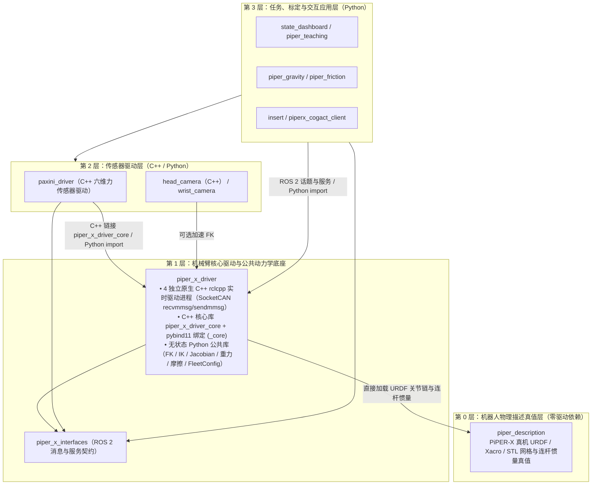

# PiPER-X workspace

硬件控制栈基于 **原生 C++17 (`rclcpp` + Linux SocketCAN) / PiPER-X V189 协议（固件 `S-V1.9-0` / `S-V1.9-1`）**，上层算法与交互应用运行于 ROS 2 Humble + Python 3.10。

## 文档索引

1. [四臂 C++ 驱动、共享动力学库与 ROS 2 接口文档](src/piper_x_driver/README.md)——C++ 实时架构、外部包 C++/Python `import` 指南、200 Hz 分层频率、重力/摩擦补偿、末端六维力估计及全部 ROS 话题/服务契约。
2. [CAN 层能力与逐条报文参考](src/piper_x_driver/CAN_PROTOCOL.md)——各报文方向、ID、字节、单位与 ROS 开放边界。

## 分层架构与单向依赖关系

全工作空间严格遵循**自上而下的单向依赖**，`piper_x_driver` 不反向依赖任何上层业务、传感器或视觉包：



- `piper_x_driver`：**全工作空间唯一机械臂 CAN 硬件入口与运动学/动力学真值底座**。在线运行由 4 个独立的原生 C++ `rclcpp` 驱动进程直接通过 Linux SocketCAN 控制 `/arm_1`～`/arm_4`（无 `pyAgxArm` / `python-can` 运行时依赖）；同时导出 C++ 头文件/库与 `pybind11` 加速的 Python 无状态数学配置接口供上层单向调用，详见 [驱动 README](src/piper_x_driver/README.md)。
- `piper_x_interfaces`：六关节目标必须完整；单位以 m、rad、rad/s、Nm 为主。
- `paxini_driver`：原生 C++ 六维力传感器驱动（直接链接 `piper_x_driver_core` 计算法兰重力方向完成实时负载重力扣除）及多姿态标定工具。
- `head_camera` / `wrist_camera`：头部双 RGB 相机 C++ HTTP 流服务与腕部 RTSP 相机/手眼外参工具包。
- `state_dashboard`：纯 ROS Web 客户端（默认 `127.0.0.1:8089`），提供四臂只读遥测总览与单臂全屏操控工作台（3D STL 姿态与实时力矢量、MIT 阻抗零重力/锁定跟踪、J/P/L 控制、力矩拆解与标零诊断），详见 [Dashboard README](src/state_dashboard/README.md)。
- `piper_teaching`：四臂主从（`master_slave`）与双向耦合（`bilateral`）示教客户端；重力补偿统一由驱动执行，详见 [示教 README](src/piper_teaching/README.md)。
- `piper_gravity`：关节重力补偿与静摩擦（双向准静态逼近 + 半和/半差解耦）标定客户端与模型库，详见 [重力标定 README](src/piper_gravity/README.md)。
- `piper_friction`：关节摩擦力与周期性齿槽/啮合脉动（Stribeck + 空间谐波）标定客户端与模型库，详见 [摩擦标定 README](src/piper_friction/README.md)。
- `insert` / `piperx_cogact_client`：基于力控与视觉的插孔策略、双臂观测采集与推理执行客户端。
- `piper_description`：**全工作空间最底层的 PiPER-X 物理几何与惯量真值包**（URDF/Xacro 与本体 STL 网格对齐 [`agilexrobotics/agx_arm_urdf`](https://github.com/agilexrobotics/agx_arm_urdf) `piper_x` 模型，零驱动依赖）；`piper_x_driver` 直接从其中的 URDF 加载 6 轴关节变换、连杆质量、质心与 3×3 惯性张量，RViz / Dashboard 3D 视图与底层动力学严格同源。

## 在其他包中复用正/逆运动学（FK / IK）、动力学与配置

凡是需要正/逆运动学、雅可比、重力/摩擦模型或读取臂配置的外部包，**直接本地 `import`（Python）或 `#include`（C++）`piper_x_driver` 提供的无状态纯函数库**（导入不会打开任何 CAN 端口或创建 ROS 节点，底层自动走同一份 C++ 实现）：

```python
from piper_x_driver import (
    FleetConfig,
    IkResult,
    default_config_path,
    forward_kinematics,       # 6 轴关节角 -> 4x4 T_base_tool 齐次变换矩阵
    inverse_kinematics,       # 4x4 矩阵或 [x,y,z,r,p,y] -> 6 轴关节角 (带 URDF 限位约束)
    link6_rotation_in_base,   # 6 轴关节角 -> 3x3 R_base_link6 旋转矩阵
    geometric_jacobian,       # 6x6 几何雅可比矩阵（frame="gripper" 或 "base_link"）
    gravity_torques,          # 6 轴 CAD 静态重力支撑力矩 (Nm)
    end_effector_wrench,      # 关节外力矩 -> 6 维末端力螺旋 (fx, fy, fz, tx, ty, tz)
    max_critical_kd,          # 由 kp 推导全姿态最大临界阻尼 kd
)

q = (0.0, 0.8, -1.2, 0.0, 0.4, 0.0)

# 1. 正/逆运动学：默认针对 link6，可传 link6 系下工具偏移 (x, y, z) m；IK 支持 4x4 矩阵或 6D [x,y,z,roll,pitch,yaw]
T_base_link6 = forward_kinematics(q)
T_base_tip = forward_kinematics(q, tool_offset_m=(0.0, 0.0, 0.16))
q_sol = inverse_kinematics(T_base_tip, q_seed=q, tool_offset_m=(0.0, 0.0, 0.16))

# 2. 读取四臂配置及带标定零偏/负载的正/逆运动学与重力矩
fleet = FleetConfig(default_config_path())
arm3_cfg = fleet.arm("arm_3")
g_model = fleet.gravity_model(arm3_cfg)
T_cal = g_model.forward_kinematics(q, tool_offset_m=(0.0, 0.0, 0.16))
q_cal = g_model.inverse_kinematics(T_cal, q_seed=q, tool_offset_m=(0.0, 0.0, 0.16))
tau_g = g_model.torques(q)
```

更多 C++ 头文件链接方式与完整 API 列表见 [`piper_x_driver` README](src/piper_x_driver/README.md#0-架构设计与外部包复用指南)。

## 环境与构建

工作空间通过 `direnv` 自动执行 [setup_env.bash](setup_env.bash)，加载 ROS 2、`.venv` 和已构建包。首次创建环境并构建：

```bash
cd <工作空间根目录>
sudo apt install ros-humble-rmw-cyclonedds-cpp
sudo apt install direnv
grep -q 'direnv hook bash' ~/.bashrc || echo 'eval "$(direnv hook bash)"' >> ~/.bashrc  # 未装 hook 时 direnv allow 不会生效
exec bash
direnv allow
uv venv --python 3.10 --system-site-packages
uv pip install --python .venv/bin/python -r requirements-dev.txt
CMAKE_BUILD_PARALLEL_LEVEL=2 .venv/bin/python /usr/bin/colcon build --symlink-install
ROS_DOMAIN_ID=213 python -m pytest -q
```

必须使用 `.venv/bin/python /usr/bin/colcon` 构建，确保生成的 ROS 入口脚本指向 `.venv` 解释器。

Python 测试覆盖公共数学库与上层客户端；依赖旧 Python 驱动的集成测试已移除。原生 C++ 驱动测试使用模拟机械臂，不连接真实硬件：

```bash
colcon test --packages-select piper_x_driver
colcon test-result --verbose
```

## 本机配置与标定

### 配置目录

本机机械臂与外设配置统一位于工作空间根目录的 `config/`（`setup_env.bash` 导出为 `PIPER_CONFIG_DIR`，详见 [config/README.md](config/README.md)），除 `config/examples/` 和 `config/README.md` 外均不入 git：

```
config/
  README.md                               # 进 git：目录与约定说明
  examples/arms/arm_1.yaml … arm_4.yaml   # 进 git：四臂示范
  examples/paxini_driver/                 # 进 git：PX6D 力传感器示范
  examples/wrist_camera/                  # 进 git：腕部相机示范
  examples/head_camera/                   # 进 git：头部相机示范
  examples/env.bash                       # 进 git：env.bash 模板
  arms/arm_2.yaml  arm_4.yaml             # 本机：有几个文件就有几个臂
  paxini_driver/  wrist_camera/  head_camera/  # 本机外设，一设备一文件
  calibration/                            # 本机所有标定结果平铺存放
  env.bash                                # 本机环境，如 ROS_DOMAIN_ID
```

- 驱动、Dashboard、示教、重力/摩擦标定页面只加载 `config/arms/` 中的臂；示教配对由启动参数 `pairs:=主臂:从臂[,...]` 指定。
- 外设单向引用机械臂（如 `arm: arm_4`），机械臂文件不引用外设。
- 臂与外设文件中的标定路径均相对所在文件解析。**未配置、文件不存在或内容无法解析，均视为未标定**。
- 运行中在 Dashboard 修改末端或补偿系数，只改写对应臂自己的文件。

示范中的默认映射：

| CAN | 机械臂 / 命名空间 | 默认末端 |
|---|---|---|
| can0 | arm_1 / /arm_1 | 示教手柄 |
| can1 | arm_2 / /arm_2 | 示教手柄 |
| can2 | arm_3 / /arm_3 | 带力传感器夹爪 |
| can3 | arm_4 / /arm_4 | 带力传感器夹爪 |

### 新机器或重新标定的完整流程

**① 生成目录骨架**：`source setup_env.bash`（或 `direnv allow`）。首次运行自动创建 `config/arms/`、`config/calibration/` 及外设目录，并从模板复制 `config/env.bash`；已有文件不会被覆盖。

**② 写臂与外设文件**：从 `config/examples/arms/` 复制本机实际连接的臂，如有外设也从 `config/examples/<package>/` 复制到对应目录，按实际情况修改：

```bash
cp config/examples/arms/arm_2.yaml config/examples/arms/arm_4.yaml config/arms/
```

- `can_port`：该臂实际接入的 SocketCAN 接口（如 `can0`）；
- `end_effector`：`teaching_handle` / `gripper` / `gripper_with_wrench`，必须与实际安装一致，重力标定基于它；
- `gravity_config` / `friction_config`：保留示范路径即可（标定后才会生成文件）；重新标定前如需保留旧结果，先备份 `config/calibration/`；
- `kp` / `kd` 等控制参数按需调整，其余字段保持示范值。

**③ 写本机环境**：在 `config/env.bash` 中设置 `ROS_DOMAIN_ID`（`0`～`101`）。两台电脑在同一网络时必须不同；修改后重新 `source setup_env.bash`。

**④ 激活 CAN**（设备断电重连或 USB 重枚举后需重新执行），二选一：

```bash
# 方法 1：按 config/arms/ 中的 can_port 激活（内部调用 sudo ip；已启用的接口不动）
ros2 run piper_x_driver can_up
# 方法 2：手动指定接口列表
for iface in can0 can1 can2 can3; do sudo ip link set "$iface" type can bitrate 1000000 && sudo ip link set "$iface" up || break; done
```

**⑤ 启动驱动**：`ros2 launch piper_x_driver all_arms.launch.py`。未标定的臂会打印 `gravity/friction not calibrated` 警告，属正常现象。

**⑥ 重力与静摩擦标定（必须先于摩擦标定）**：摩擦辨识要从实测力矩中扣除重力矩，重力模型不准会污染摩擦结果。

```bash
ros2 run piper_gravity web --port 8091   # 浏览器打开 http://127.0.0.1:8091/
```

逐臂执行 `J1 → J6` 队列，结果保存到 `gravity_config`，并请求驱动重新加载。原理与命令行方式见 [重力标定 README](src/piper_gravity/README.md)。

**⑦ 关节与夹爪摩擦标定**：

```bash
ros2 run piper_friction web --port 8090  # 关节：http://127.0.0.1:8090/  夹爪/示教手柄：http://127.0.0.1:8090/gripper.html
```

依次标定 `J1 → J6` 与夹爪（示教手柄同样适用），结果保存到 `friction_config`。采集开始时 `friction_scale` 会在驱动内存中被临时置 `0`；标定结束后在页面点击“恢复 0.85”，或重启驱动恢复臂文件中的值。详见 [摩擦标定 README](src/piper_friction/README.md)。

**⑧ 验证**：重启驱动，确认不再出现 `not calibrated` 警告；在 Dashboard 中确认各臂在线且零力拖动手感正常。

**⑨ 外设与任务配置**（仅涉及本机实际安装的设备；本机文件不进 git）：

| 设备 / 功能 | 本机设备与标定 | 包内静态配置 | 标定命令 |
|---|---|---|---|
| PX6D 六维力传感器 | `config/paxini_driver/*.yaml` → `config/calibration/` | [px6d.yaml](src/paxini_driver/config/px6d.yaml) | `ros2 run paxini_driver calibrate --arm <臂> run`，见 [README](src/paxini_driver/README.md) |
| 腕部相机 | `config/wrist_camera/*.yaml` → `config/calibration/` | [board.yaml](src/wrist_camera/config/board.yaml) | `ros2 run wrist_camera calibrate --arm <臂>`，见 [README](src/wrist_camera/README.md) |
| 头部相机 | `config/head_camera/*.yaml` → `config/calibration/` | [head_camera.yaml](src/head_camera/config/head_camera.yaml) | `ros2 run head_camera head_camera calibrate ...`，见 [README](src/head_camera/README.md) |
| 示教耦合参数 | 启动参数 `pairs` | [bilateral_teaching.yaml](src/piper_teaching/config/bilateral_teaching.yaml) | — |
| 插孔任务外参 | `src/insert/config/extrinsics.yaml` | — | 见 [README](src/insert/README.md) |
| CogACT 客户端 | `src/piperx_cogact_client/config/calibration.yaml` | [default.yaml](src/piperx_cogact_client/config/default.yaml) | 见 [README](src/piperx_cogact_client/README.md) |

## 启动驱动、Dashboard 与示教

完成上述配置与 CAN 激活后，各终端保持同一 `ROS_DOMAIN_ID`：

```bash
# 终端 1：启动 config/arms/ 中全部臂的驱动（启动后自动使能六关节并进入 MIT 重力补偿模式；Ctrl+C 退出时切入固件原生零力拖动）
ros2 launch piper_x_driver all_arms.launch.py

# 终端 2：启动 Web Dashboard（浏览器打开 http://127.0.0.1:8089/）
ros2 run state_dashboard state_dashboard --port 8089

# 终端 3：启动示教（pairs 指定主臂:从臂；默认 dry_run:=true 仅预览，正式运行加 dry_run:=false）
ros2 launch piper_teaching teaching.launch.py pairs:=arm_2:arm_4

# 四臂一键彻底断电失能
ros2 launch piper_x_driver power_off.launch.py
```

- **重力与摩擦力补偿**：驱动在外部 MIT 模式内计算 `gravity_scale × g(q, end_effector)`（在目标位置偏置与 `t_ff` 之间守恒分配）及 `friction(q, dq)`（直接叠加至 `t_ff`），详见 [驱动 README](src/piper_x_driver/README.md)。
- **MIT 滑块与停止**：滑块从实测姿态初始化；停止滑块或停止示教后，驱动保持在 MIT 重力补偿模式；如需彻底断电失能，在页面点击“失能”或运行 `power_off`。
- **末端闭合零位标定**：需七轴全失能、新鲜反馈及显式物理闭合确认，经 CAN 写入设备零点并校验 `0..0.1 mm` 回读。

## 模型与 RViz

VS Code 已在 [.vscode/settings.json](.vscode/settings.json) 与 [piper_x.code-workspace](piper_x.code-workspace) 配置 `urdf-visualizer.packages`，可直接预览 URDF。

```bash
# 独立浏览模型
ros2 launch piper_description display_urdf.launch.py

# 跟随真机反馈显示（按配置自动选择示教手柄或夹爪模型，加 rviz:=false 仅发布 TF）
ros2 launch piper_description follow.launch.py namespace:=arm_1
```
