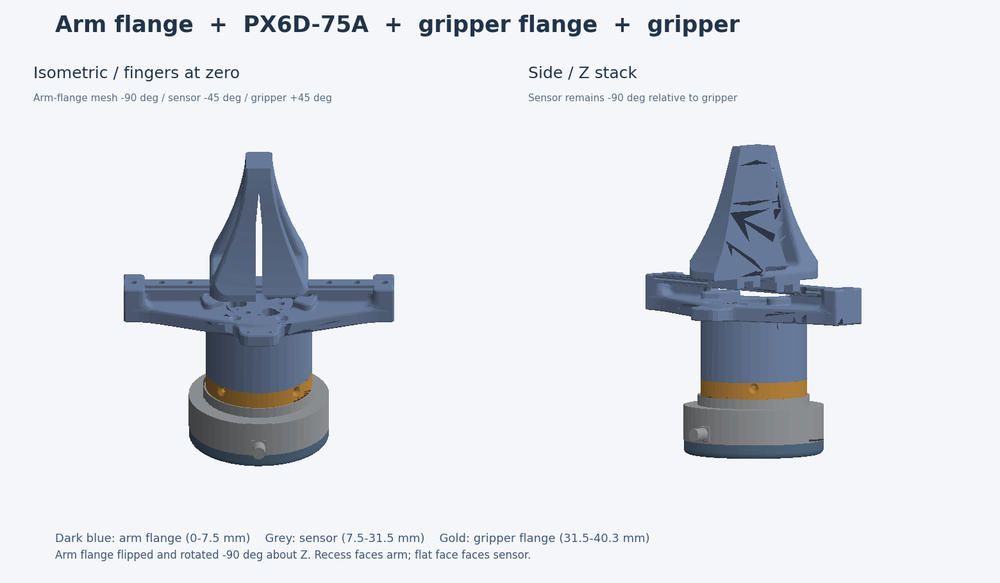

# 臂侧法兰 + PX6D-75A + 夹爪侧法兰 + 夹爪

`gripper_with_wrench.xacro` 是独立的组合模型，根坐标在臂侧法兰的机械臂贴合面中心，+Z 朝夹爪。新法兰、力传感器、夹爪侧法兰和夹爪沿 Z 堆叠：



| 部件 | 网格 | 在根坐标系中的 Z 范围 | 质量 |
| --- | --- | --- | --- |
| 臂侧打印法兰 | `meshes/px6d75_arm_flange.stl` | 0～7.5 mm | 0.242 N ÷ 9.81 = 0.024669 kg |
| PX6D-75A 力传感器 | `meshes/px6d75.stl` | 7.5～31.5 mm | 0.18 kg，来自[官方手册](https://cdn-cn.paxini.com/store/pro/unknown/5cda08c8-aa4f-4a07-8c9a-bcbb6413a229.pdf) |
| 夹爪侧打印法兰 | `meshes/px6d75_gripper_flange.stl` | 31.5～40.3 mm | 0.168 N ÷ 9.81 = 0.017125 kg |
| 去掉旧法兰的夹爪底座 | `meshes/gripper_base_without_flange.STL` | 40.3～92.8 mm | 0.45 kg − (0.356 N ÷ 9.81) = 0.413710 kg |
| 左、右手指 | `meshes/link7.STL`、`meshes/link8.STL` | 保留原夹爪关节 | 各 0.025 kg |

臂侧法兰已上下翻转：带凹槽的一侧朝机械臂，平整面朝传感器；两者连接位于 Z=7.5 mm。传感器与夹爪侧打印法兰的连接位于 Z=31.5 mm；夹爪侧法兰的平整面贴传感器，上表面位于 Z=40.3 mm。夹爪底座网格已移除原来 Z=0～10.5 mm 的法兰，并下移 10.5 mm，使保留下来的底面为自身 Z=0。`joint7`、`joint8` 的安装高度也相应下移 10.5 mm，原有运动轴、关节限位和手指网格保持不变。

臂侧法兰网格在上下翻转后又绕 −Z 轴旋转 90°。以独立末端根坐标系计，传感器绕 Z 轴为 −45°、夹爪为 +45°，传感器相对夹爪仍为 −90°。外圈四孔具有 90° 对称性，旋转后仍与传感器背面的 M4 孔对齐；内圈六孔与 `link6` 的对孔角由完整整机模型中的固定连接关节处理。

原 `gripper_base` 的 0.45 kg 惯性参数按**包含被移除的旧法兰**处理。旧法兰实测重力 0.356 N，使用其原 STL 外形估算质心和惯量，再从原参数中扣除；剩余底座的质心/惯量因此是估算值。传感器的质心/惯量按均匀圆柱估算；两片打印法兰按各自 STL 实体、均匀材料估算。整套模型质量约 **0.685505 kg**，其中包含两片手指。

原始模型保留在 `meshes/px6d75_original/`、`meshes/px6d75_arm_flange_original/`、`meshes/px6d75_gripper_flange_original/` 和 `meshes/gripper_base.STL`。两片打印法兰原 STL 均以毫米计：臂侧法兰上下翻转并绕 −Z 旋转 90° 后采用 `X=(z原−37.5)/1000`、`Y=(37.5−x原)/1000`、`Z=(7.5−y原)/1000`；夹爪侧法兰仍采用 `X=(x原−28.5)/1000`、`Y=(28.5−z原)/1000`、`Z=y原/1000`。

完整整机模型为同级的 `urdf/piper_description_with_wrench.urdf`：以 `piper_description.urdf` 为基准保留机械臂部分，J6 模型零位沿原关节自身 Z 轴补偿 +45°，即新模型 J6=0 对应旧模型 J6=+45°；限位为 [−175°, +175°]，其余关节参数保持不变。通过 `joint6_to_arm_sensor_flange` 将新末端接到 `link6`，安装面位于 `link6` 的 Z=0。连接关节绕 Z 轴 −90°，相对原 +90° 安装旋转 180°，六个臂侧安装孔仍与 `link6` 对齐；此时传感器相对 `link6` 为 −135°，夹爪为 −45°，组件内部相对安装保持不变。独立末端模型仍为 `gripper_with_wrench.xacro`，原整机 `piper_description.urdf` 保持不变。可验证两个模型：

```bash
source ./setup_env.bash
xacro src/piper_description/urdf/paxini/gripper_with_wrench.xacro -o /tmp/gripper_with_wrench.urdf
check_urdf /tmp/gripper_with_wrench.urdf
check_urdf src/piper_description/urdf/piper_description_with_wrench.urdf
```
